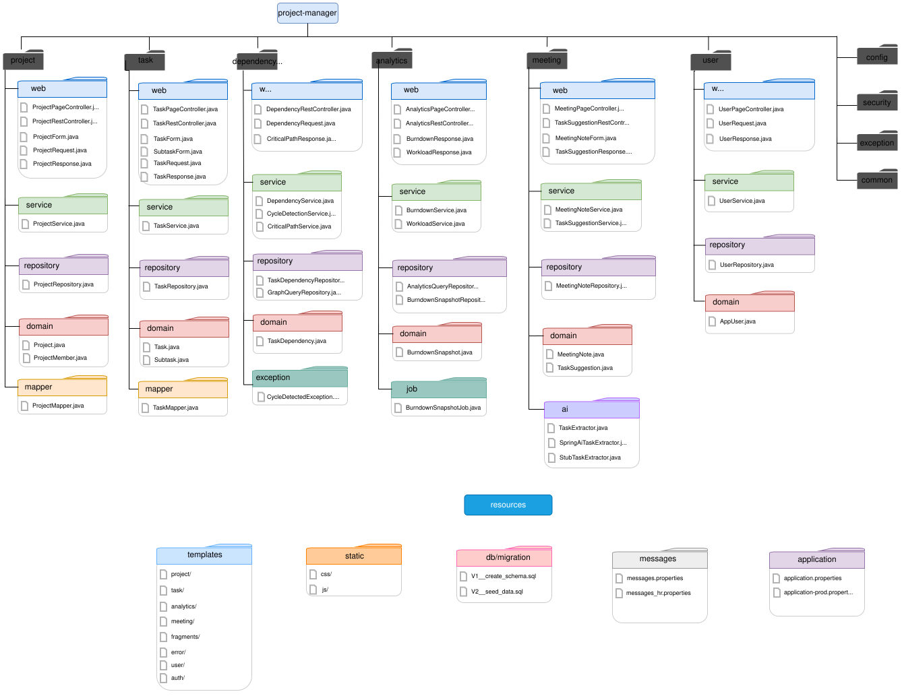

# Project manager 

Application for managing projects, tasks with dependencies, subtasks, critical-path computation, burndown metrics. Its AI-assistant turns free-text meeting notes into candidate tasks, which the project lead accepts or dismisses one by one.

## Project structure

Project structure is a combination of a package-by-feature and layered architecture. 

Every feature has its own package, which is then divided into layers (`web`, `service`, `repository`, `domain`).
All packages have some shared features, such as `common` (shared utilities), `config` (Spring configuration), `security` (authentication and authorization) and `exception` (custom exceptions).

## Platform choices

- **Hosting**: Render (web service, Frankfurt)
- **Database**: Neon PostgreSQL (Frankfurt)
- **AI provider**: Google Gemini (via Spring AI)

## Domain model

## Prototype

- Figma file: https://www.figma.com/design/J8fzbXuHwKIUMOLCqgbaSi/Project-and-task-management?node-id=0-1&t=ARnO8CqVVVWQxsEJ-1
- High-fidelity screens (PDF export): [docs/prototype.pdf](docs/prototype.pdf)
- Low-fidelity wireframes: [docs/design/wireframes.pdf](docs/design/wireframes.pdf)
- Design decisions and contrast check: [docs/design-rationale.md](docs/design-rationale.md)

## Prototype => templates

| Figma frame | Template | Deviations |
|-----------|----------|-------------------------------------------------|
| 01_Project list | `project/list.html` | Project names are links, shown in the link colour so they look clickable. |
| 01b_Project list - empty | `project/list.html` (shown when the search returns no projects) | none |
| 01c_Project list - delete confirm | `fragments/confirm-dialog.html`, `static/js/confirm.js` | The dialog is a native `<dialog>` element. Delete is also kept on the edit page, as a second way to delete a project. |
| 01m_Project list - mobile | `project/list.html` + `@media (max-width: 640px)` in `app.css` | The same table is shown as cards below 640 px, not a separate page. Edit and delete icons are added to each card. |
| 02_Project detail | `project/detail.html` | Only the Tasks section exists so far. Dependencies, Schedule, Metrics and Meeting notes tabs come with M3 and M4. The critical path card shows "Not calculated yet" until the computation exists. Task titles are links to the edit page, and each row has edit and delete icons, like the project list. Each task title also shows its subtasks done, for example "1/2 subtasks". |
| 02b_Project detail - task saved | `project/detail.html` + `fragments/flash.html` | The flash message is shown after creating or editing a project as well, not only after saving a task. |
| 03_Task form, 03b_Task form – errors, 03m_Task form – mobile | `task/form.html` | The same template for new and edit; below 640 px the buttons stack, as in 03m. The edit page has a Subtasks card under the form (add, mark done, delete) and a Delete task button; the prototype has no frame for subtasks. The assignee list contains only members of the project. There is no start date field: the start will come from the dependency schedule (M3). |
| 07_Meeting notes | not implemented yet (issue #20) | not implemented yet (M3) |
| no frame | `error/404.html`, `error/error.html` | Not in the prototype. Simple pages inside the common layout, with a link back to the project list. |

## CI

## Live application

https://project-manager-i464.onrender.com

Hosted on Render's free plan (Frankfurt) with a Neon PostgreSQL database (Frankfurt). The free service sleeps after about 15 minutes without traffic, so the first request after a pause can take about two minutes while the application starts.