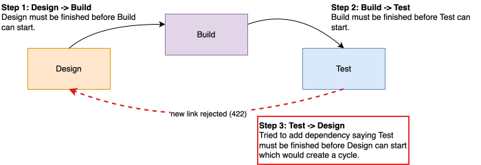
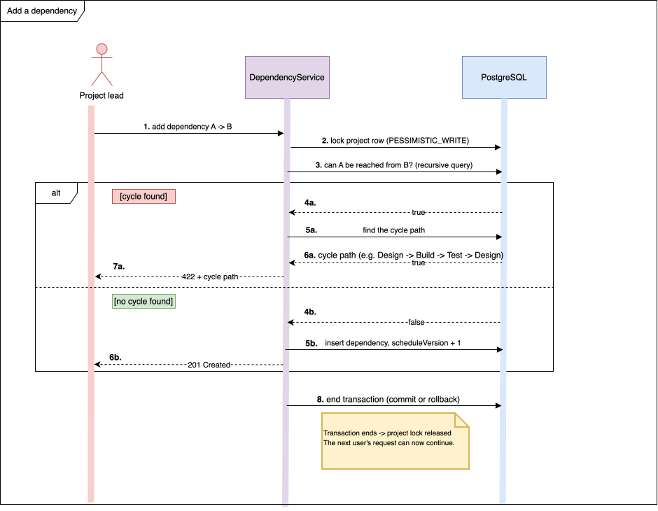
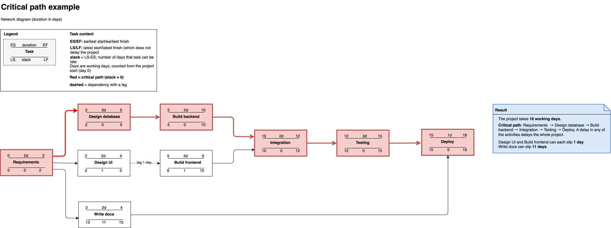

# ADR 0002: Graph computation strategy

## Status

Accepted (2026-10-12)

## Context

The dependencies between tasks form a graph, and the application has two main tasks to perform on this graph:

1. **Prevent cycles**

When a dependency is created or edited, it must be rejected if it would create a loop (e.g. A waits for B, B waits for C, C waits for A), because then no task in the loop could ever start.

Illustration of a cycle:

2. **Compute the critical path**

For every task, the application calculates the earliest and latest start and finish, and the slack (i.e. how much the task can be delayed without delaying the whole project). Tasks with zero slack form the critical path since they have no flexibility in their scheduling. The same schedule is also used for the weekly workload chart.

The main requirement of the project is that this graph work does not load the entire project on every request. Also, two users can edit dependencies at the same time, so the cycle check must stay correct when that happens. 

ADR-0001 already decided that dependencies are stored as `TaskDependency` entities and that graph reads use projections. This ADR decides where and how the two calculations run.

## Decision

### 1. Cycle check in the database

A => B creates a cycle only if A can already be reached from B by following the existing dependencies. This is a reachability problem, which can be solved by a recursive query in PostgreSQL, defined in `DependencyGraphRepository`, in a following manner:
- The query starts at B and follows dependencies forward, only inside the same project
- It uses `UNION` instead of `UNION ALL` to avoid visiting the same task twice
- The query returns a boolean (yes/no) answer, so no rows are loaded into memory. The service layer uses this answer to accept or reject the new dependency.

The following changes cause a cycle check to run:

| Action | Check needed? |
|--------|----------------|
| Creating a new dependency | Yes |
| Editing only `lagDays` field | No (the graph stays the same) |
| Editing predecessor or successor | Yes (the edited dependency itself is excluded from the reachability check) |
| Deleting a dependency | No (removing a link cannot create a cycle) |

If a cycle is found, a second query finds the actual path (e.g. *Design → Build → Test → Design*), so the user sees why the link was rejected. This query is more expensive, but it only runs when there is an error to show.

The following diagram shows steps of trying to add a new dependency. I created it while planning this part of the project, to make the order of the steps (locking, checking and saving) clear to myself before implementing it, but found it useful to keep in the ADR as well because it illustrates the concurrency problem and approach taken to solve it.

Three participants are involved: the project lead, the service and the database. The process starts with the user trying to add a dependence A → B. The service first locks the project row meaning that, while the request is running, no other request can modify dependencies in the same project. This prevents two users from creating a cycle at the same time. Then the service queries the database to check if starting from B and following the arrows, it can reach A.
Two scenarios are possible:
1. Answer is **yes**, A can be reached. Adding A → B would close a loop, so the service asks for the exact loop (for example Design → Build → Test → Design) and rejects the request with 422, showing the user that loop.
2. Answer is **no**, A cannot be reached. The link is safe, so the service saves it, increases scheduleVersion so the schedule is recalculated, and answers 201 Created.

Finally, the lock is released when the request finishes, and the next user can continue.

**Concurrency**

If two users add A → B and B → A at the same moment, both checks could pass, because neither sees the other's uncommitted link. To prevent this, the service first locks the project row (`PESSIMISTIC_WRITE`), so dependency changes in one project happen one at a time.

**Responses**

A cycle returns `422` with a `ProblemDetail` that includes the cycle path. A duplicate dependency returns `409`.

### 2. Critical path in Java, with a cache

The critical path is computed in a plain Java class, `CriticalPathCalculator`, with no Spring or database code inside:

**Input:** the two projections from ADR 0001, `TaskNode(id, durationDays, status)` and `Edge(predecessorId, successorId, lagDays)`

**Order:** tasks are sorted topologically with Kahn's algorithm. Because cycles are already prevented, this always succeeds; if it ever doesn't, an exception is thrown, because that means a bug

**Forward pass:** earliest start and finish, starting from the project's `startDate`

**Backward pass:** latest start and finish, then slack = latest start − earliest start

**Duration:** `estimateHours/8`, rounded up to whole working days. Weekends are skipped

**Real progress:** a task in progress starts from its `startedAt`, and a finished task uses its `completedAt`, so the forecast reflects what actually happened, not only the plan

The result is cached with Caffeine under the key (`projectId, scheduleVersion`). `Project.scheduleVersion` is incremented in the same transaction as every change that affects the schedule: dependencies, estimates and task statuses. A request first reads the current `scheduleVersion` (one small query) and then uses the cache if that version is already computed.

The following example shows a small project with nine tasks. The critical path takes 16 working days; tasks off the critical path have 1 or 11 days of slack. The same example is used as a test case for `CriticalPathCalculator`.

## Alternatives rejected

1. **Cycle check in Java**

Loading all dependency pairs of the project and searching them in Java is simple and easy to unit test. It was rejected because it transfers all of the project's dependencies on every edit, while the recursive query does the same search without moving any data.

2. **A transitive closure table**

A separate table storing every pair of tasks connected by any path makes the cycle check a single lookup. But every insert and delete would have to update many rows of that table, which is a lot of complexity for the size of graphs in this application.

3. **`SERIALIZABLE` isolation or a PostgreSQL advisory lock instead of the project-row lock**

`SERIALIZABLE` would also prevent the concurrency problem, but it requires retrying failed transactions. An advisory lock works too, but it is PostgreSQL-specific and less visible in the code. Locking the project row is simpler and easy to see in the service method, and dependency edits are rare enough that waiting is not a problem.

4. **Critical path in SQL**

The forward pass could be written as a recursive query, but it would have to follow every possible path through the graph, which grows very fast in graphs with many dependencies. The backward pass is also awkward to express in SQL.

5. **Storing the schedule on tasks and recalculating only the affected part**

Saving the earliest start and finish in `task` columns and recalculating only the tasks after a change would read even less data. It was rejected because the backward pass, and therefore the slack, still needs the whole graph, and the stored values could become inconsistent with the dependencies if something goes wrong.

6. **Clearing the cache on change (`@CacheEvict`) instead of a version key**

This only clears the cache of the instance that handled the change. If the application runs on two instances, the other one would keep showing an old schedule. The version key works correctly on any number of instances.

7. **Calendar days instead of working days**

Simpler to calculate, but a task estimated at 16 hours would appear to finish over a weekend, which is not realistic.

## Consequences

### Gained

1. The cycle check doesn't load anything into the application, and its cost depends only on the size of the project's own graph.
2. Concurrent edits can't create a cycle.
3. `CriticalPathCalculator` is pure Java, so it can be tested with plain unit tests and small hand-made graphs.
4. When nothing has changed, the schedule is not recalculated at all. This is also used for the measured performance improvement (before and after the cache).
5. The cache stays correct even with more than one application instance.

### Accepted costs

1. The recursive query is native PostgreSQL SQL, so it has to be tested with Testcontainers against a real PostgreSQL database.
2. Dependency changes in the same project are processed one at a time. This is acceptable because they are rare.
3. When the cache is empty or outdated, the calculation still reads all task nodes and dependencies of the project. These are small projections (IDs and numbers), not entities, so this is acceptable.
4. Every service method that changes dependencies, estimates or statuses must remember to increment `scheduleVersion`. This is covered by tests, because a missed increment would show an outdated schedule.
5. Working days skip weekends but not public holidays.